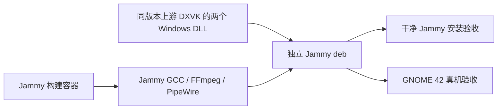
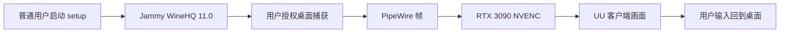

# Ubuntu 22.04 Jammy 兼容分支

基线为上游 UUWay v1.5.7。本分支先覆盖 Ubuntu 22.04.5 LTS x86_64、GNOME 42 Wayland、NVIDIA NVENC（目标机器为 RTX 3090）。保留原有双后端构建，AMD 真机不在首轮验收范围。使用本系统的运行库，不升级发行版，不混用 24.04 的 APT 源。

## 阶段与验收

1. **能安装**：在干净的 Jammy 容器构建单独的 `_jammy_amd64.deb`；在第二个干净容器安装并运行 CLI、控制台、用户运行时打包与服务配置、安装向导演练和卸载。确认原生库解析正确，更新器不把上游普通 Ubuntu 包当成 Jammy 包。
2. **能远程控制**：在目标 OS 原生的 GNOME Wayland 会话中确认驱动、Vulkan、PipeWire 和屏幕共享；用 UU 远程客户端连接可见桌面并验证画面和键鼠。退出会话后再次检查可用性和服务状态。容器通过不等于此项通过。

构建和打包入口保留在 `packaging/`；`config/jammy-dxvk-bootstrap.json` 固定了参考资产和构建输入；`scripts/uuway_platform.py` 与 `scripts/uuway_update_apply.py` 负责 Jammy WineHQ 源和更新目标识别。





## 可复现构建与安装演练

需要 Docker 和构建依赖下载网络，在仓库根目录运行：

```bash
packaging/build-deb.sh --target ubuntu-22.04 --version 1.5.7+jammy.1
packaging/test-deb.sh --target ubuntu-22.04 build/deb/uuway_1.5.7+jammy.1_jammy_amd64.deb
```

Jammy 自带 FFmpeg 4.4；原生 ELF 组件在 Jammy 构建，并由 Debian 工具写入实际的编解码库依赖。两个 DXVK Windows PE DLL 和许可证来自固定哈希的上游 v1.5.7 .deb，只重用这三个文件，不使用上游包内的 Linux 二进制。Jammy 系统不运行上游 24.04 的编译器；若 DXVK 源或补丁改变，先用上游 24.04 工具链重新构建并重新固定对应 PE 资产。

Jammy 包和原来的 `uuway_*_amd64.deb` 不是同一个更新目标。同版本上游 Release 没有 Jammy 包，不能通过上游更新器替换成本分支的构建；本地兼容版先手动安装。此分支不改 GitHub Release 或发布配置。

## 实机试装前

在本机已经登录的 GNOME 桌面终端执行：

```bash
echo "$XDG_SESSION_TYPE"
gnome-shell --version
nvidia-smi
```

首轮用现有桌面和驱动，不启用自动登录，不切换显卡驱动。看见 `wayland` 并且 RTX 3090 驱动正常后，用 Jammy 专用包进行试装：

```bash
sudo apt install ./uuway_1.5.7+jammy.1_jammy_amd64.deb
uuway setup
uuway doctor
```

只对自己控制的桌面授权，在远端实际看见桌面并操作键鼠后才算完成。不要在只有 SSH 且无本地恢复入口的会话里改变显示登录或驱动配置。
